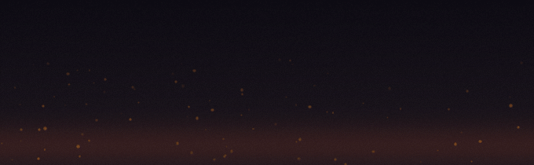
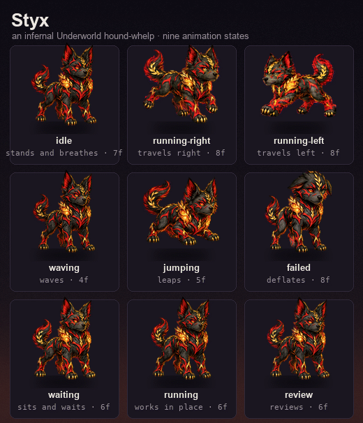

# Styx

> A tiny infernal Underworld hound-whelp with ember-lit laurel details and mismatched crimson-and-green eyes.



Styx is a [Hermes Agent](https://hermes-agent.nousresearch.com/docs) pet package: a `pet.json` plus an
animated `spritesheet.webp`, dropped into the desktop mascot / terminal pet slot. He idles, runs, waves,
jumps, deflates, waits and reviews along with whatever the agent is doing.

## Install

Petdex installs are by slug; this one ships as a local package, so clone it into the pets dir:

```sh
git clone https://github.com/Cwjiee/styx ~/.hermes/pets/styx
hermes pets select styx     # adopt + enable
hermes pets doctor          # sanity-check the sheet parses
```

Already have Hermes? Copying `pet.json` and `spritesheet.webp` into `~/.hermes/pets/styx/` is the whole
install — nothing else in this repo is required. In a running session, `/pet styx` adopts him, `/pet off`
hides him, `/pet scale 0.5` resizes him.

## Animations



Nine state rows, driven from the agent's activity (`error` → `celebrate` → `just completed` →
`awaiting input` → tool running → reasoning → busy → idle):

| Row | Row name        | Frames | Hermes state | Plays when |
|----:|-----------------|-------:|--------------|------------|
| 0   | `idle`          | 7      | `idle`       | nothing is in flight |
| 1   | `running-right` | 8      | `run`        | travelling right across the screen |
| 2   | `running-left`  | 8      | `run`        | travelling left across the screen |
| 3   | `waving`        | 4      | `wave`       | a turn finished cleanly / greeting |
| 4   | `jumping`       | 5      | `jump`       | a success beat, e.g. every todo done |
| 5   | `failed`        | 8      | `failed`     | a tool call or turn just failed |
| 6   | `waiting`       | 6      | `waiting`    | blocked on you for input |
| 7   | `running`       | 6      | `run`        | a tool is running (in-place work) |
| 8   | `review`        | 6      | `review`     | the model is reasoning / reviewing |

## Spritesheet

`spriteVersionNumber: 2` — the 8 × 11 atlas:

| | |
|---|---|
| Sheet size | 1536 × 2288 px |
| Grid | 8 columns × 11 rows |
| Cell | 192 × 208 px |
| Columns used | 8 max; short rows leave trailing cells fully transparent (the renderer trims them) |
| Rows 0–8 | the nine animation states above |
| Rows 9–10 | the v2 look-direction rows (16 frames, reserved by the spec) |
| Loop timing | 1100 ms per state loop, 6 frames/state nominal (Hermes defaults) |

Frames within a row are left-packed, so a row's real frame count is simply the number of leading cells
that aren't empty — which is why the table above reads 7/8/8/4/5/8/6/6/6 rather than a uniform 6.

## Repo layout

```
styx/
├── pet.json                 # id, display name, description, spriteVersionNumber
├── spritesheet.webp         # the 1536×2288 v2 atlas
├── assets/
│   ├── styx-walk.gif        # crawl-across banner (README hero)
│   └── styx-states.gif      # all nine states side by side
└── tools/
    └── make_showcase_gifs.py  # regenerates both GIFs from the atlas
```

## Regenerating the GIFs

Needs Pillow and ImageMagick (`magick`) on `PATH`:

```sh
python3 tools/make_showcase_gifs.py
```

The script crops each row's non-blank frames straight out of `spritesheet.webp`, builds one shared
255-colour palette across every frame, quantizes with Floyd–Steinberg dithering, and lets ImageMagick
fold the sequence into delta frames (`-layers OptimizeFrame`). The walk banner uses the `running-right`
row unmirrored, since the art already faces right.
